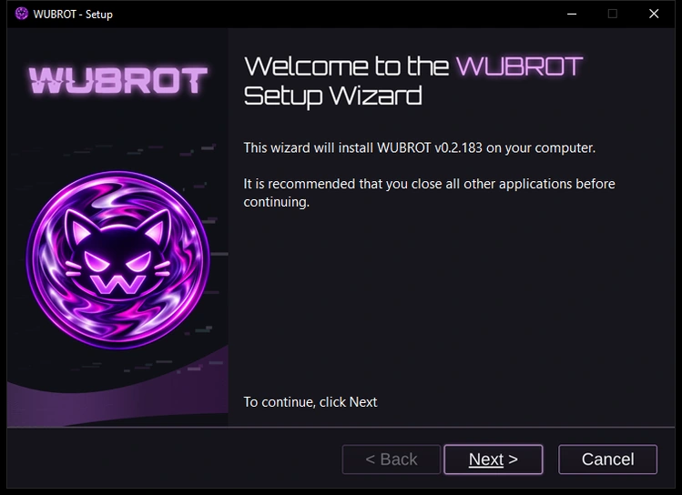

# WUBROT

**A distortion audio effect by WUBWARE AUDIO.** Add digital grit to bass and other sounds with the Crush Field, or use ROT DNA to shape the tone with a sample. Start with one of three factory presets or load your own WAV or MP3.

**[Windows](https://github.com/spockverse/WUBROT/releases/latest/download/WUBROT-setup.zip)** · **[macOS](https://github.com/spockverse/WUBROT/releases/download/v0.2.184/WUBROT-0.2.184-macOS-Universal.pkg)** · **[Linux](https://github.com/spockverse/WUBROT/releases/download/v0.2.184/WUBROT-0.2.184-Linux-x86_64.deb)** · [All releases](https://github.com/spockverse/WUBROT/releases) · [Changelog](CHANGELOG.md)

<p align="center">
  
</p>

## Install on Windows

1. Download `WUBROT-setup.zip` and extract it with **Extract All**.
2. Close your DAW and run `WUBROT-setup.exe` from the extracted folder. Follow the setup wizard. If WebView2 is missing, setup downloads the Microsoft runtime.
3. Reopen your DAW, rescan VST3 plugins if needed, and add **WUBROT** as an effect on an audio or mixer track.

<p align="center">
  
</p>

Setup installs the plugin to the standard Windows VST3 folder.

```text
C:\Program Files\Common Files\VST3\WUBROT.vst3
```

The installer is unsigned, so Windows may show **Unknown publisher**. To uninstall, find **WUBROT VST3** under **Apps** in Windows Settings.

## Install on macOS

Close your DAW and open the macOS `.pkg`. It installs the VST3 and Audio Unit in the system plug-in folders. The installer is unsigned and has not been notarized by Apple. Reopen your DAW and rescan plug-ins after setup.

## Install on Linux

Close your DAW and run this command from the download folder. The package installs the VST3 in `/usr/lib/vst3` and pulls in WebKitGTK.

```sh
sudo apt install ./WUBROT-0.2.184-Linux-x86_64.deb
```

Reopen your DAW and rescan plug-ins.

## Current support

| Platform | Format | Requirements and validation |
|---|---|---|
| Windows | x64 VST3 | A 64-bit VST3 host and Microsoft Edge WebView2 Runtime |
| macOS | Universal VST3 and Audio Unit | Targets macOS 13 and later on Intel and Apple Silicon. Installer, VST3 host, and `auval` checks passed on macOS 15.7.9 on Intel. |
| Linux | x86-64 VST3 | Verified on Ubuntu 24.04 with X11 and WebKitGTK 4.1. |

- **Plugin missing from your DAW?** Rescan VST3 effects. In FL Studio, open **Options → Manage plugins → Find installed plugins**. If you previously installed a portable copy in a custom scan folder, move it out of that folder so your DAW finds the setup-installed copy.
- **Audio works but the editor is blank?** Close the DAW and rerun setup to check the WebView2 installation. You can also get the runtime from [Microsoft Edge WebView2](https://developer.microsoft.com/microsoft-edge/webview2/).

## Updates

On Windows, open **Settings → Updates → Check for updates** in WUBROT. When a newer Windows version is available, choose **Update Now**, then close your DAW to let the updater apply it. For manual updates on any platform, get the matching download from the [Releases page](https://github.com/spockverse/WUBROT/releases).
