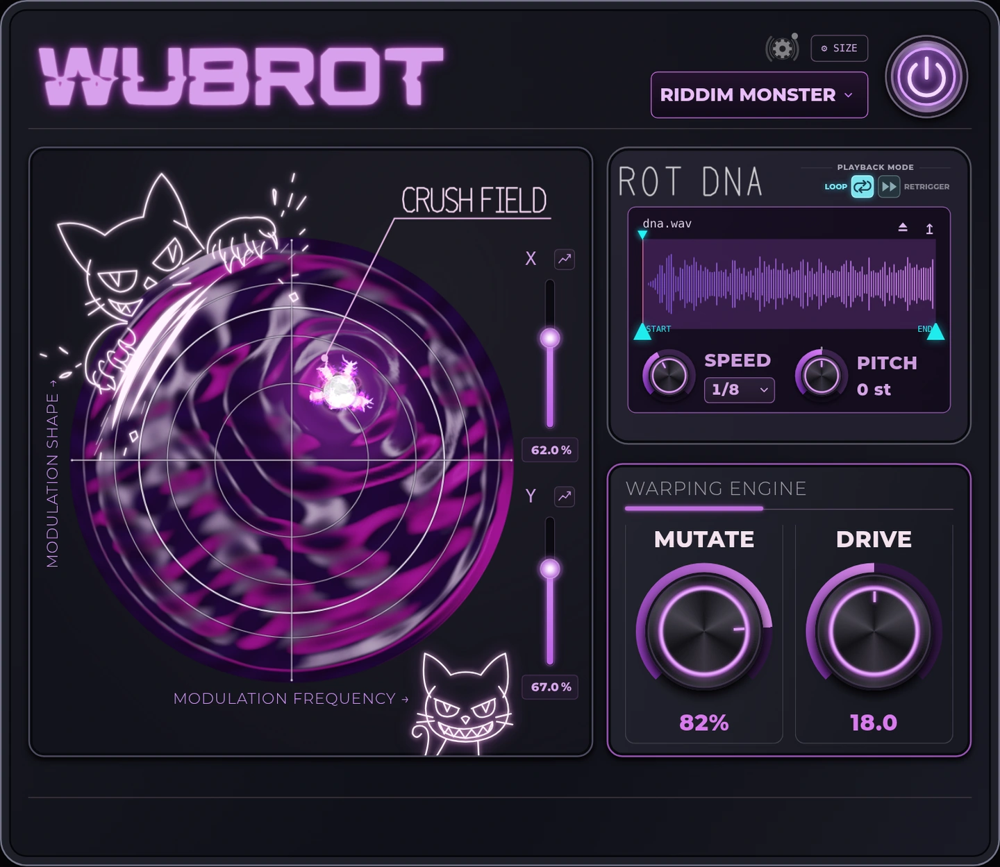

# WUBROT

**A Windows VST3 audio effect by WUBWARE AUDIO.** Add digital grit to bass and other sounds with the Crush Field, or use ROT DNA to shape the tone with a sample. Start with one of three factory presets or load your own WAV or MP3.

**[Download WUBROT for Windows](https://github.com/spockverse/WUBROT/releases/latest/download/WUBROT-setup.zip)** · [All releases](https://github.com/spockverse/WUBROT/releases) · [Changelog](CHANGELOG.md)

<p align="center">
  
</p>

## Install on Windows

1. Download `WUBROT-setup.zip` and extract it with **Extract All**.
2. Close your DAW and run `WUBROT-setup.exe` from the extracted folder. Follow the setup wizard. If WebView2 is missing, setup downloads the Microsoft runtime.
3. Reopen your DAW, rescan VST3 plugins if needed, and add **WUBROT** as an effect on an audio or mixer track.

<p align="center">
  
</p>

Setup installs the plugin to the standard Windows VST3 folder.

```text
C:\Program Files\Common Files\VST3\WUBROT.vst3
```

The v0.2.183 installer is unsigned, so Windows may show **Unknown publisher**. To uninstall, find **WUBROT VST3** under **Apps** in Windows Settings.

## Current support

WUBROT is available for **Windows x64** and requires a DAW that hosts **64-bit VST3 audio effects**. The editor uses **Microsoft Edge WebView2 Runtime**. macOS, Linux, and other plugin formats are currently unavailable.

- **Plugin missing from your DAW?** Rescan VST3 effects. In FL Studio, open **Options → Manage plugins → Find installed plugins**. If you previously installed a portable copy in a custom scan folder, move it out of that folder so your DAW finds the setup-installed copy.
- **Audio works but the editor is blank?** Close the DAW and rerun setup to check the WebView2 installation. You can also get the runtime from [Microsoft Edge WebView2](https://developer.microsoft.com/microsoft-edge/webview2/).

## Updates

Open **Settings → Updates → Check for updates** in WUBROT. When a newer stable version is available, choose **Update Now** to download it, then close your DAW to let the updater apply it. The [Releases page](https://github.com/spockverse/WUBROT/releases) also lists a separate portable Windows x64 VST3 ZIP for manual installation.
